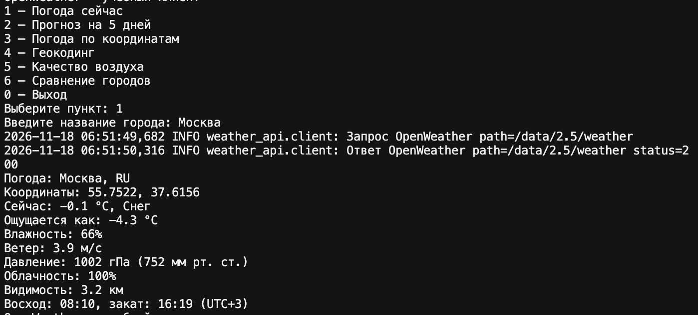
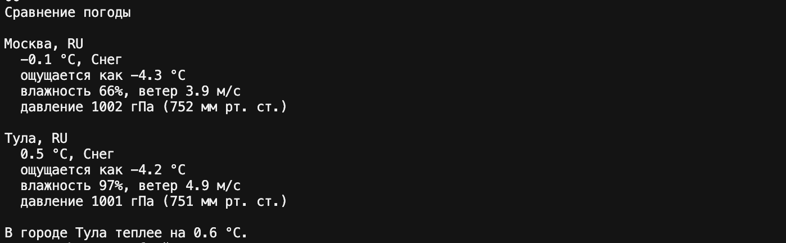
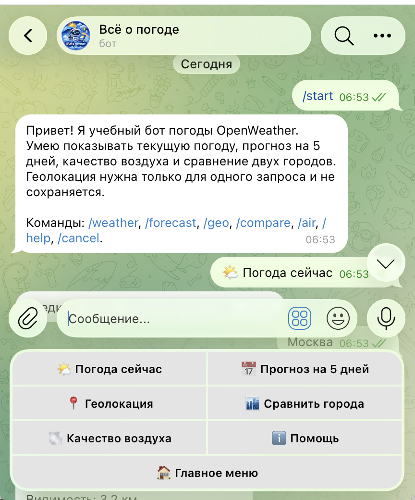
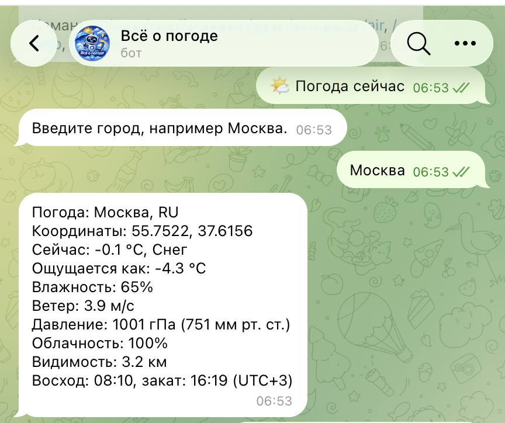
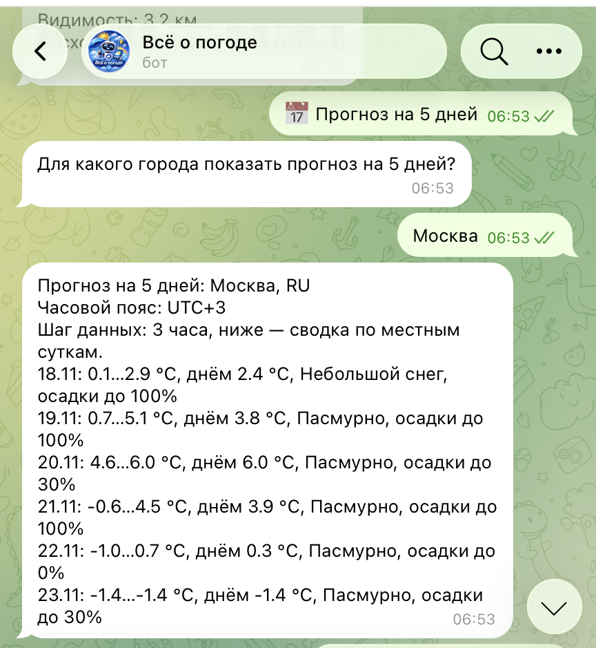
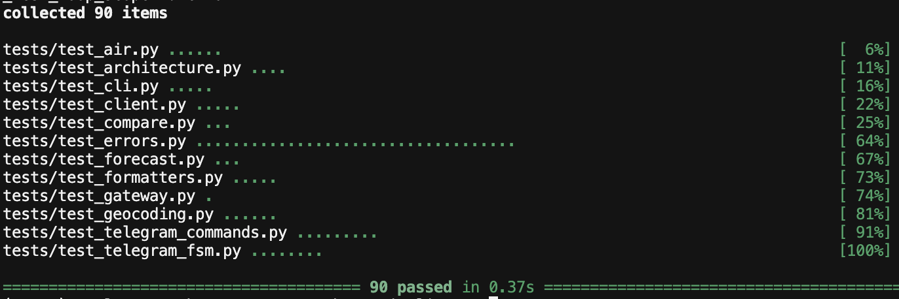

# OpenWeather API Client

Клиент OpenWeatherMap на Python 3.11: общий модуль API, консольное меню и Telegram-бот на aiogram 3.

## Цель задания

Проект «Кейс 1: API-погода».

Нужно было получить данные OpenWeatherMap по актуальным HTTPS-endpoint и показать их двумя независимыми интерфейсами: CLI и Telegram-ботом. 

## Функциональные возможности

1. Текущая погода по названию города.
2. Прогноз на 5 дней. API отдаёт шаг 3 часа, программа сворачивает его в сводку по местным суткам.
3. Прямой геокодинг города и обратный геокодинг координат.
4. Погода по координатам вместе с ближайшим местом.
5. Качество воздуха и индекс AQI от 1 до 5.
6. Сравнение текущей погоды двух городов.
7. Расширенная карточка: давление в гПа и мм рт. ст., видимость, облачность, восход и закат в часовом поясе города.

Для погоды и прогноза запрос уходит с `units=metric` и `lang=ru`. Геокодинг и качество воздуха этих параметров не принимают, поэтому клиент их туда не добавляет.

Температура показывается в °C, ветер — в м/с. Восход, закат и слоты прогноза переводятся из Unix-времени в часовой пояс города (`timezone` из ответа API, сдвиг в секундах). Время замера качества воздуха API отдаёт в UTC, и в карточке оно так и подписано.

## Архитектура

Слои не смешиваются:

- `weather_api/` знает только HTTP, разбор JSON, проверку городов и координат. Aiogram отсюда не импортируется.
- `services/` собирает сценарии: геокодинг перед запросом воздуха, сравнение двух городов, текст для человека.
- `cli.py` показывает меню и печатает уже готовый текст.
- `telegram_bot/` принимает команды, кнопки и шаги FSM. Синхронный `requests` из обработчика не вызывается: `AsyncWeatherGateway` выполняет сервис через `asyncio.to_thread()`.
- `telegram_main.py` только запускает long polling.

Состояние диалога хранится в `FSMContext` и `MemoryStorage` отдельно для каждого пользователя. Общей переменной «текущий шаг» нет.

## Структура файлов

```text
.
├── .env.example
├── .gitignore
├── README.md
├── cli.py
├── pyproject.toml
├── requirements.txt
├── telegram_main.py
├── screenshots/
│   ├── 01_cli_weather.png
│   ├── 02_cli_compare.png
│   ├── 03_telegram_menu.png
│   ├── 04_telegram_weather.png
│   ├── 05_telegram_forecast.png
│   └── 06_tests.png
├── services/
│   ├── formatters.py
│   └── weather_service.py
├── telegram_bot/
│   ├── bot.py
│   ├── gateway.py
│   ├── handlers.py
│   ├── keyboards.py
│   ├── states.py
│   └── texts.py
├── tests/
│   ├── test_air.py
│   ├── test_architecture.py
│   ├── test_cli.py
│   ├── test_client.py
│   ├── test_compare.py
│   ├── test_errors.py
│   ├── test_forecast.py
│   ├── test_formatters.py
│   ├── test_gateway.py
│   ├── test_geocoding.py
│   ├── test_telegram_commands.py
│   └── test_telegram_fsm.py
└── weather_api/
    ├── client.py
    ├── exceptions.py
    ├── logging_utils.py
    ├── models.py
    ├── parsers.py
    └── validation.py
```

Каталог `.venv/` создаётся локально и в git не входит.

## Установка на macOS

Нужен Python 3.11 или новее. В этой среде использовался Python 3.11.9.

```bash
cd openweather-api-client
python3.11 -m venv .venv
source .venv/bin/activate
pip install -r requirements.txt
```

Поставленные версии: requests 2.34.2, python-dotenv 1.2.4, aiogram 3.32.0, pytest 9.2.0, pytest-asyncio 1.5.0.

Готового виртуального окружения в папке не было, поэтому создано новое `.venv`.

## Настройка .env

```bash
cp .env.example .env
```

В `.env` подставьте свои значения:

```text
OPENWEATHER_API_KEY=replace_with_your_openweather_key
TELEGRAM_BOT_TOKEN=replace_with_your_telegram_bot_token
```

Ключ OpenWeatherMap берётся в кабинете OpenWeather. Токен бота выдаёт [@BotFather](https://t.me/BotFather). Файл `.env` указан в `.gitignore` и в репозиторий не кладётся. В коде, README и тестах боевых ключей нет.

## Запуск CLI

Из корня проекта, с активированным `.venv`:

```bash
python cli.py
```

Меню:

```text
1 — Погода сейчас
2 — Прогноз на 5 дней
3 — Погода по координатам
4 — Геокодинг
5 — Качество воздуха
6 — Сравнение городов
0 — Выход
```

Координаты вводятся как `55.7558, 37.6173`: сначала широта, затем долгота. Город можно уточнить страной: `Москва, RU`.

Без `OPENWEATHER_API_KEY` программа останавливается и не делает запрос.

## Запуск Telegram-бота

```bash
python telegram_main.py
```

Бот работает через long polling Telegram Bot API. Нужны обе переменные: `OPENWEATHER_API_KEY` и `TELEGRAM_BOT_TOKEN`.

Команды: `/start`, `/weather`, `/forecast`, `/geo`, `/compare`, `/air`, `/help`, `/cancel`.

К `/weather`, `/forecast` и `/air` можно сразу добавить город: `/weather Москва`. К `/geo` можно сразу добавить координаты.

Кнопки главного меню:

- 🌤 Погода сейчас
- 📅 Прогноз на 5 дней
- 📍 Геолокация
- 🏙 Сравнить города
- 🌫 Качество воздуха
- ℹ️ Помощь
- 🏠 Главное меню

В личном чате сценарий геолокации показывает кнопку с `request_location=True`. Это разовая точка, не live location. Её можно заменить текстом `55.7558, 37.6173`. В группе кнопки запроса геолокации нет, остаются координаты текстом. Точка не пишется в FSM и не сохраняется на диск.

Команды и кнопки меню обрабатываются раньше шага FSM, поэтому ими можно уйти из любого состояния. `/help` справку показывает и текущий шаг не стирает. `/cancel` и «Главное меню» сценарий отменяют.

## Тестирование

Тесты не используют настоящий API-ключ, не ходят в OpenWeatherMap и не запускают Telegram.

```bash
source .venv/bin/activate
pytest
```

Повторный запуск `python -m pytest -q --tb=short` в этой среде:

```text
90 passed in 0.39s
```

Покрыты клиент и мок HTTP, геокодинг, прогноз и местная полночь, качество воздуха, сравнение городов, форматирование, коды 401, 404, 429, 5xx, таймаут, битый JSON, переходы FSM, команды и кнопки, отмена сценария, отказ от постоянной геолокации.

Отдельная проверка импортирует `weather_api` и `cli` в чистом процессе и убеждается, что aiogram там не загружается.

## Демонстрация работы

Шесть снимков ниже сделаны после проверки CLI, Telegram-бота и автоматических тестов. В логе CLI виден только путь запроса и код ответа, без ключа.

### CLI: погода сейчас

Пункт меню `1`, город Москва. Клиент запрашивает `/data/2.5/weather` и получает статус 200. На экране карточка: −0.1 °C, снег, ощущается как −4.3 °C, влажность 66 %, ветер 3.9 м/с, давление 1002 гПа (752 мм рт. ст.), облачность 100 %, видимость 3.2 км, восход 08:10 и закат 16:19 (UTC+3). Нижний край окна немного обрезан.



### CLI: сравнение городов

Пункт меню `6`: Москва и Тула. В обоих городах снег. В Москве −0.1 °C, в Туле 0.5 °C. Итог на экране: в Туле теплее на 0.6 °C. Рядом видны влажность, ветер и давление.



### Telegram: старт и главное меню

Бот «Всё о погоде» отвечает на `/start` приветствием и списком команд. Внизу reply-клавиатура: «Погода сейчас», «Прогноз на 5 дней», «Геолокация», «Сравнить города», «Качество воздуха», «Помощь» и «Главное меню». Пользователь уже нажал «Погода сейчас».



### Telegram: погода сейчас

После кнопки «Погода сейчас» бот просит город. На «Москва» приходит та же карточка, что в CLI: −0.1 °C, снег, ощущается как −4.3 °C, влажность 65 %, ветер 3.9 м/с, давление 1001 гПа (751 мм рт. ст.), облачность 100 %, видимость 3.2 км, восход 08:10 и закат 16:19 (UTC+3).



### Telegram: прогноз на 5 дней

Кнопка «Прогноз на 5 дней», город Москва. В ответе часовой пояс UTC+3 и пометка, что шаг данных — 3 часа, а на экране сводка по местным суткам. Видны дни с 18.11 по 23.11: минимум и максимум, дневная температура, описание и вероятность осадков.



### Автоматические тесты

Прогон pytest: собрано 90 тестов, все зелёные, внизу экрана `90 passed in 0.37s`. В списке файлы клиента, геокодинга, прогноза, воздуха, сравнения, форматирования, ошибок, CLI, команд и FSM Telegram.



## Ограничения

- Вместо VKBottle и VK LongPoll реализован Telegram-бот на aiogram 3. Клиента ВКонтакте в проекте нет. Для исходной формулировки задания это частичное выполнение с альтернативной платформой.
- Автоматические тесты не ходят в OpenWeatherMap и не запускают Telegram: HTTP закрыт моком `requests.Session`, бот проверяется через `Dispatcher.feed_update`. Живой API и бот показаны на скриншотах ручной проверки.
- Бесплатный тариф OpenWeatherMap ограничивает частоту запросов. Код отвечает на HTTP 429 понятным текстом и сам запрос не повторяет.
- Качество воздуха запрашивается по координатам. Для города программа сначала вызывает прямой геокодинг и берёт первый результат.
- Время AQI показывается в UTC: endpoint воздуха не присылает сдвиг часового пояса.
- Геолокация пользователя не запрашивается постоянно и никуда не сохраняется. Состояние диалога живёт в памяти процесса и пропадает после остановки бота.

## Итоги выполнения VPd04

Собран модульный клиент актуальных endpoint OpenWeatherMap:

- `/data/2.5/weather`
- `/data/2.5/forecast`
- `/data/2.5/air_pollution`
- `/geo/1.0/direct`
- `/geo/1.0/reverse`

Поверх него работают консольное меню и Telegram-бот с кнопками и шестью состояниями FSM. Исходное задание VPd04 предполагало бота ВКонтакте на VKBottle и VK LongPoll. Вместо них здесь Telegram-бот на aiogram 3. Это частичное выполнение исходного задания: клиент погоды и пользовательские сценарии есть, мессенджер заменён на альтернативную платформу.

Ошибки 401, 404, 429, 5xx, сеть, таймаут и некорректный JSON превращаются в короткие русские сообщения. Ключ и URL с `appid` в логи и в текст для пользователя не попадают. Автоматические тесты проходят без секретов и без внешней сети: 90 passed.
